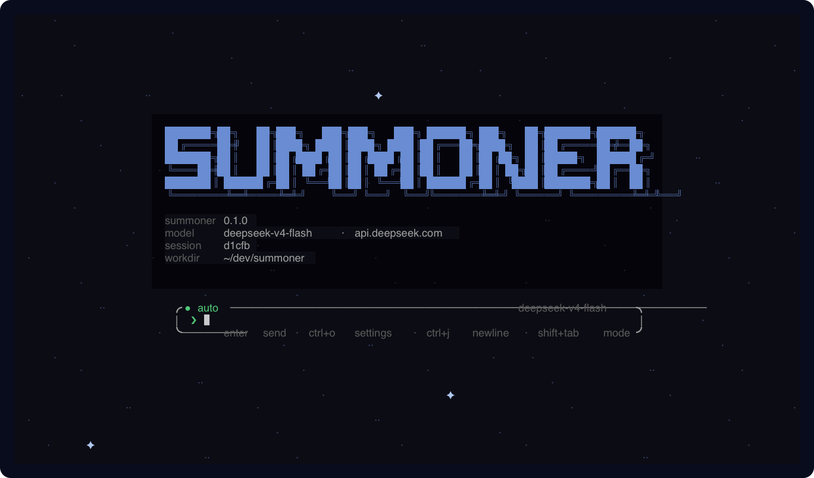

# Summoner

Summoner is a local coding harness. You point it at a model. OpenAI
`POST /v1/chat/completions` hosts work (glm, kimi, grok, llama.cpp,
config). Anthropic Messages and Gemini use their native APIs. Auth is
an API key or an OAuth2 token that becomes a bearer. `summon` is the command that starts Summoner with a specific model; a bare `summoner` uses your default.



What it actually does: it holds the job so the model does not have to.
That job is Work. Plan, execute, verify. You keep the objective. The
model edits this directory (hash-anchored, cannot leave the workspace).
A check command you named is the pass. Model prose is not.

0.1.0 alpha. Private git. Not on crates.io.

## Requirements

Rust 1.90. macOS or Linux. SSH to `ThomGardiner/sigil` (TUI crates).
Windows is unsupported.

## Install

```sh
cargo install --path . --force
summon -V
summoner -V
```

Expect `summoner 0.1.0 (<git revision>)` (the same binary as `summon`).
Build fails without Sigil.

## Usage

```sh
summon grok
summon anthropic
summon kimi -p "What is in Cargo.toml?"
```

Add any other host in `~/.mage/config.toml`:

```toml
[endpoint.local]
base_url = "http://127.0.0.1:8081/v1"
model = "whatever-the-server-calls-it"
api_key = "local"
```

Then `summon local`. `effort = "low"` on a row (or `--effort LEVEL`,
`/effort LEVEL` in the interface) sets the reasoning effort for that
seat — set it only on a seat whose model reasons, because a host that
does not take `reasoning_effort` answers 400; `price = { input, output, cached }` in USD per million tokens
prices every round in `/stats` and the footer. A workflow seat keeps
its own row's effort and price; `--effort` and `/effort` set the
driving seat and any role seat whose row does not say. `summon endpoints` probes `GET /models` for each
name so a dead host fails before the first tool round. `summon login NAME`
runs RFC 8628 device-code login when that row has `device_url`.

Keys live in `~/.mage/credentials.toml`, a sealed ChaCha20-Poly1305
blob (mode 0600, written through a rename). The wrapping key is a
32-byte item in the OS store (`summoner` / `seal`), not a file next to
the blob. `cat` of the file does not show keys. File mode still needs
that OS item: a locked keychain is an error, not a plaintext leftover
in `config.toml`. `summon login NAME --key` prompts for a key (echo
off) and stores it; `summon logout NAME` forgets it and any login
token. A plaintext `api_key` in `config.toml` is moved into that file
the first time Summoner runs, and it says so once. Resolution order is
the host's environment variable, the store, then `api_key` in
`config.toml`.

If you want the OS store instead, set `secrets = "keychain"` in
`config.toml` (or `MAGE_SECRETS=keychain`). On macOS that is one
Keychain entry holding every secret, read and written through
`/usr/bin/security`, so the one-time "Always Allow" is granted to
Apple's signed tool and survives every rebuild of Summoner; Windows uses
Credential Manager and Linux the Secret Service, one entry per secret.
A locked keychain is reported, never worked around with a file, and
the two modes never fall back to each other.

Built-ins: chat/completions seats `glm`, `glm-intl`, `qwen`, `kimi`,
`grok`, `copilot`, `openai`, `openrouter`; native wires `anthropic`
(Messages) and `gemini`. `summon login copilot` is GitHub device login;
chat then exchanges that token for a Copilot session token. Kimi is a
key (`KIMI_*` or `~/.kimi-code/credentials`). Environment keys are the host's own
(`XAI_API_KEY`, `ZAI_*`, `OPENAI_API_KEY`, `OPENROUTER_API_KEY`,
`ANTHROPIC_API_KEY`, `GEMINI_API_KEY`). Overlay `wire = "anthropic"`
on any `[endpoint.NAME]` row. See [`config.example.toml`](config.example.toml).

```sh
summon --goal "make cargo test pass"
summon --steps PLAN.md
```

`summon --name TEXT` (or `/name TEXT`) names a session; `--session`
takes a name or an id prefix, `summon sessions` lists both, and
`summon export [ID|NAME]` prints the transcript as Markdown.
`summon logs` lists the last 20 per-run diagnostic logs. `summon doctor`
prints the running binary path and reports crashed or incomplete runs.
Logs older than 14 days are removed unless their process is still active.

`--goal` keeps one objective until `.mage/check.toml` is green and a
judge says stop. The judge answers `done`, `continue`, `stalled`, or
`impossible`; the last two end the goal with the reason, and three
turns without a workspace change end it as stalled. `--steps` hands
the model one numbered item at a time. A turn that ends while a
background command it started is still running is deferred — no
verdict, no repair strike, up to three times — until the job exits or
the model kills it. A `### Heading` under
`## Steps` groups the items that follow it into a phase. Every turn
carries the ledger — phases as Roman numerals, `[x]` done, `[/]` this
step, `[ ]` later, `[!]` blocked — to the model and to the transcript.
Both isolate in a git worktree (`<repo>-worktrees/<id>`) when you are
in a repo. Exit 0 commits the files the run changed as
`summon: <objective>` (files over 5 MB and anything the run did not
touch are left in place and named), fast-forwards your branch, and
removes the tree; a tree that cannot fast-forward or still holds
uncommitted files is kept and named, and the exit code is 1.
`--here` stays put.

In plan mode the model reads and proposes; nothing runs. Toggle plan
mode off and the next message accepts the selected plan — the
transcript and the model both see `plan accepted`; `/plan reject`
discards it instead. `diagnostics` and `definition` route each file to its
language module (`definition` also lists references and applies rename).

### Workflows

A workflow seats each step on its own model. Roles are `scout`, `plan`,
`implement`, `review`, `judge`, and `summary`; a role the workflow does
not name runs on the seat you started with.

```toml
# ~/.mage/config.toml
workflow = "cheap-scout"      # optional default

[workflows.cheap-scout]
plan = "grok"
review = { endpoint = "glm", model = "glm-5.3" }
judge = "grok"
```

`summon -w cheap-scout`, `/workflow cheap-scout` in the interface, or the
`workflow` key picks one; `summon workflows` lists them. In the
interface every card action has a verb too:

```
/workflow                    the card
/workflow NAME | off         apply a saved workflow, or none
/workflow list | show        saved workflows · the live seats
/workflow set ROLE ENDPOINT [MODEL]
/workflow clear ROLE
/workflow save NAME          write the live seats as [workflows.NAME]
/workflow default NAME       the workflow new sessions start with
```

`summon --gui` opens the session in a desktop window (a build with
`--features gui`). The window is the Codex shape on Sigil: a left rail
that switches the Files, Changes, Worktrees, and Plan panes and lists this
workspace's sessions; a main column with the transcript, a composer card,
and an Auto/Plan switch; a right rail that shows the open pane with real
widgets — clickable file rows, +/− chips that open a file's hunks, an
Edit/Save file view. The title bar's changes badge is live. The same
`App`, keys, and layouts drive the terminal and the window.

The screen is a set of panes on one session. `ctrl+e` (or `/pane
files`) opens the repository tree beside the chat; `ctrl+l` the plan
ledger; `ctrl+p` hides or restores the pane. In the tree: `ctrl+→`
focuses it, `↑↓` move, `←→` collapse or expand, `PgUp/PgDn/Home/End`
jump, Enter opens a directory or attaches `@path` to your prompt, and
a right-click (or the mouse) opens a menu — attach, open in `$EDITOR`,
insert path. `ctrl+←` or `esc` returns to the composer. `/pane off`
closes the pane. `/layout focus`, `run`, `files`, and `review` are
presets, `/layout "chat | files 30%"` sets the split, and
ctrl+shift+←/→ resizes it. The layout persists in `~/.mage/config.toml`
as `layout`.

`ctrl+x` (or `/pane diff`, `/diff`) shows the changes against the base:
the worktree base for a `--goal`/`--steps` run, `HEAD` otherwise. Each
row is `+added −removed path`; Enter or `→` opens that file's hunks,
`↑↓` scroll them, `←` or `esc` returns to the list, and the right-click
menu adds view hunks. `/diff PATH` jumps to one file. After a turn that
changed the tree, the transcript gets one `changes: N files · +a −r`
line. The same data is `summon diff [PATH]` (the patch), `summon diff
--stat`, and `summon diff --json`.

`→` on a file in the tree (or `/view PATH`, or the menu's view file)
reads it in the view pane with line numbers; lines the diff added are
green with a `+`. `↑↓`, `PgUp/PgDn`, `Home/End` scroll, `o` opens it in
`$EDITOR`, `esc` returns to the tree. `e` edits the file in place: the
keyboard goes to the file (type, Enter, arrows, Home/End), the caret is
the inverted cell, `ctrl+s` saves, and `esc` leaves — with unsaved text a
second `esc` discards it. The tree, the diff, and the view
follow the file system: a change on disk relists, re-diffs, or reloads
the pane within about half a second.

In the diff pane `t` keeps only the files the last turn edited (the
header says `· last turn`), `c` copies the patch on show to the clipboard
(OSC 52 in the terminal; the system clipboard in the window), and a pane
80 columns or wider shows a file's hunks side by side, old on the left.
`summon diff --turn N` (or `--turn last`) is the same filter for the
latest session in this directory.

`/pane worktrees` lists the `summon/*` worktrees of this repository:
branch, commits ahead of the base, dirty or clean, the session that ran
there, and the directory. Enter or `→` opens that worktree's diff (`esc`
comes back); the right-click menu offers show diff, merge (the same
ff-only merge a run ends with; a dirty tree is refused), remove
worktree (only when clean and fully merged), and insert path. `summon
worktrees` prints the same rows; `summon worktrees --json` as JSON.

The card takes the keyboard (↑↓ role, enter picks a seat, `d` returns
it to the driving seat, ←→ cycles saved workflows, `s` saves) and the
mouse: click a role to pick its seat, drag a role onto another to copy
the seat, click a saved name to apply it. The settings modal, model
picker, and authentication card take clicks as well. The session log
records the model behind every reply.

With a `scout` seat, a `--steps`, `--goal`, or plan-mode job opens with
a read-only brief of the files, conventions, and helpers the objective
touches. With a `review` seat, a turn whose checks passed is read by
the reviewer before it completes; a rejection sends the findings back
as the next instruction and counts against the same three-attempt
limit as a failed check.
The `task` tool delegates work to fresh child sessions. A model can emit
up to four `task` calls in one response. Summoner runs them concurrently.
Each `implement` child edits a separate Git worktree from the same tracked
`HEAD`. The parent tracked files must be clean before the batch starts.
Implement children get file tools, but no shell or language-server tools.
They cannot start builds, tests, formatters, or background jobs. Summoner
combines their patches before it changes the parent checkout. A conflict
keeps the child worktrees and leaves the parent unchanged. After a clean
apply, Summoner removes the child worktrees. The parent verifies once and
commits. Outside Git, only one implement child can write the current
workspace.

A `research` child reads the parent workspace without a worktree and cannot
write or run commands. Each child uses the endpoint context window and can
run four provider rounds. If the parent has a token budget, the children
share its remaining tokens. A 300-second deadline covers each child. Children
have no web tools or another `task` tool.
`grep` takes `glob`, honors `.gitignore`, and lists matching files
when the pattern is empty.
`web_search` reads DuckDuckGo HTML without a key. `[search] backend = "bing"`
keeps the Bing RSS compatibility path; `[search] backend = "brave"` with
`api_key` (or `BRAVE_API_KEY`) uses the Brave Search API. Every result says
which backend answered. Language modules cover Rust,
TypeScript/JavaScript, Python, and Go. They select the server from the file and
a project marker, then keep one connection per module in a polyglot checkout.
Rust passes initialization options that disable check-on-save, build scripts,
proc macros, and `cargo --all-targets`. Explicit Cargo commands still run
through `run_command`.

A workspace `.mage/config.toml` may force a built-in module:

```toml
[lsp]
module = "rust"
```

Repository config cannot supply executable argv. A trusted
`~/.mage/config.toml` may use `[lsp] command = ["server", "--stdio"]` when a
built-in module does not fit.

Unknown flags exit 1. A red verify gate exits 2. A run that stops
short — a budget breach, a stalled or impossible goal, or an aborted
turn — exits 3.
JSON turn receipts keep model text separate from the changed-path list
and every configured completion check.

## Limits

- File tools cannot leave the workspace. Commands run under Seatbelt or
  bubblewrap with network denied. `--net` allows sockets. `--no-sandbox`
  disables process containment. A missing sandbox backend is a hard stop.
- Home is still `~/.mage`. Env is still `MAGE_*`.
- Not crates.io. No Sigil SSH, no build.
- An older `mage` binary may still be on `PATH`. Use `summon`.
- No MCP client, hook API, or runtime plugin loader. Language modules are
  compiled in and reviewed with Summoner. A CLI with a README is a tool the
  model already knows how to run through `run_command`; a skill under
  `~/.mage/skills` or `.mage/skills` carries instructions; the bus carries
  mail between sessions.

## Docs

- [Work](docs/architecture.md)
- [`config.example.toml`](config.example.toml)
- [`policy.example.toml`](policy.example.toml)
