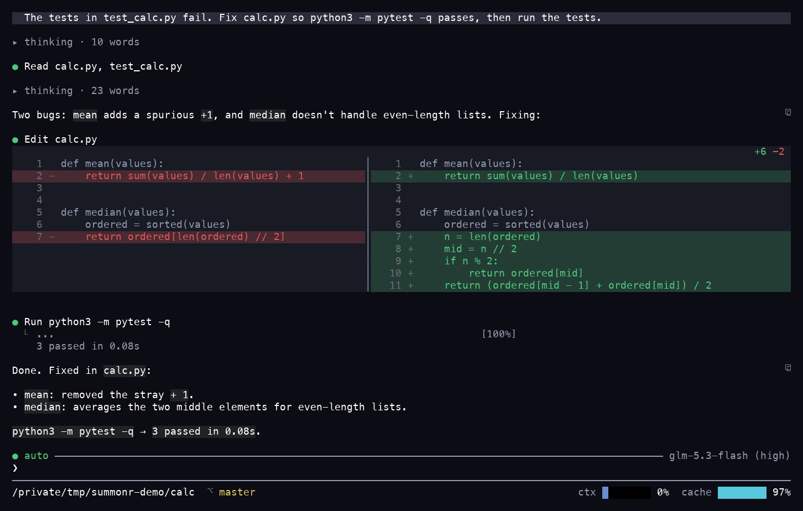

# summonr

A terminal coding agent for any model that keeps working until your check command passes.

- **Light on tokens and memory**: median input tokens per solved task under half, and median memory under a third, of every agent paired with it on the same model ([benchmarks](#benchmarks)).
- **Any model, your plan or your key**: 28 providers built in, sign-in for ChatGPT and SuperGrok plans, and any OpenAI-compatible server.
- **Works until it passes**: `--goal` runs until your check command exits 0 and a second model call agrees the goal is met, inside a time or token budget you set.
- **Sessions that talk**: message any running session with `@name`, even one on another model or provider. [Try it](#coordinate-work-live).
- **Parallel children that land their own edits**: each implement child works in its own checkout, and the parent applies each finished one.
- **Browses like you do**: drives your installed Chrome, Edge, or Brave in a profile of its own that stays signed in, and searches the web with no API key. Turn on `browser` and `search` under `[modules]`.
- **Works while you're away**: schedule a goal for 3 AM with `summonr cron`, fire one from a webhook, or text it from Telegram. It tells you whether the check passed.
- **Remembers**: tell it a preference once and every later session in that repository knows it. The notes are plain Markdown you can edit.

[Docs](docs/guide/README.md) | [Reference](docs/guide/reference.md) | [Scripting API](docs/api.md) | [Benchmarks](#benchmarks)



## Install

macOS and Linux:

```sh
curl -fsSL https://summonr.dev/install.sh | sh
```

Windows (PowerShell):

```powershell
irm https://summonr.dev/install.ps1 | iex
```

Each [release](https://github.com/manaforged/summonr/releases) ships binaries for macOS (Apple silicon), Linux (x86_64 and arm64, glibc or static musl), and Windows (x86_64). The installer downloads the archive's `.sha256` file from the same release, checks the archive's SHA-256 against it, and installs `summonr` to `~/.local/bin`, or `%LOCALAPPDATA%\Programs\summonr\bin` on Windows. Set `SUMMONR_VERSION` to pick a release tag, `SUMMONR_INSTALL_DIR` to change the directory, and `SUMMONR_LIBC=gnu` for the glibc build on Linux.

To install by hand, download the archive and `SHA256SUMS` from [GitHub Releases](https://github.com/manaforged/summonr/releases), then check the archive:

```sh
shasum -a 256 -c SHA256SUMS --ignore-missing
```

On Windows, compare the output of `Get-FileHash <file> -Algorithm SHA256` with the line in `SHA256SUMS`. A checksum from the same release catches a corrupted download, not a tampered release. To check where a file came from, verify its build attestation:

```sh
gh attestation verify <file> --repo manaforged/summonr
```

To update, run `summonr update`. To uninstall, delete the binary: `~/.local/bin/summonr` or `%LOCALAPPDATA%\Programs\summonr\bin\summonr.exe`.

### Build from source

You need Rust 1.98 or later, Git, CMake, and a C and C++ compiler. On Windows, use the MSVC Rust toolchain and Visual Studio C++ Build Tools.

```sh
cargo install --git https://github.com/manaforged/summonr --locked
```

Run the same command to update. To uninstall, run `cargo uninstall summonr`.

## First run

1. Run `summonr` in a project directory.
2. Pick a provider in the list that opens on the first run, or type `/login` later.
3. Paste the API key, or sign in to a coding plan in the browser.

To skip the prompt, set a key such as `ANTHROPIC_API_KEY` and run `summonr anthropic`.

For a first bounded task, [configure a check and run a goal](#usage) with `--max-secs 1800`. Inspect the result with `summonr diff --turn last`; the receipt reports which checks ran and whether they passed. Commands run as your account with no sandbox, so use a container when a task must not access the rest of your machine.

## Desktop window

`summonr --gui` opens the same session in a Sigil desktop window. The release binaries and the default build leave it out; build with the `gui` feature:

```sh
cargo install --git https://github.com/manaforged/summonr --locked --features gui
summonr --gui
```

## Usage

Set a key and start a session:

```sh
export ANTHROPIC_API_KEY=...
summonr anthropic
```

If you have a coding plan, sign in instead of using a metered key:

```sh
summonr login              # every plan and key, with its status
summonr login openai       # sign in with ChatGPT Plus or Pro, or paste a key
summonr login grok         # sign in with SuperGrok or X Premium+, or paste a key
summonr openai
```

Run one prompt and exit:

```sh
summonr anthropic -p "why does cargo test fail?"
```

Work until the tests pass:

```sh
mkdir -p .summonr
echo 'check = "cargo test"' > .summonr/check.toml
summonr anthropic --goal "make cargo test pass" --max-secs 1800
```

`--goal` retries failed checks without an attempt limit until the check exits 0 and a second model call agrees that the goal is met. A budget, cancellation, harness error, or judge verdict of `stalled` or `impossible` can stop it short. Numbered steps retain their configured attempt limit. Exit codes: 0 done, 1 harness error, 2 check still red (summonr runs the check once more when a budget or an abort stops the run), 3 stopped short with no check configured, or with a passing check and an unmet goal. CI can branch on them.

More to try:

- `/undo` drops the last turn and restores the files. Every turn is a git checkpoint.
- Child sessions are on by default in interactive sessions (`task` module): batch, background, poll, and kill. Children run on the parent's endpoint and model unless the workflow assigns the role elsewhere; turn it off in the Modules rows of `/settings` or with `task = false` under `[modules]` in `~/.summonr/config.toml`.
- An implement child works in `<repo>-children/<id>`, a checkout beside the repo that shares `target/`, `node_modules`, the paths listed in `.summonr/linked` and `.agents/linked`, and the parent's git objects, without a branch. The parent applies the child's edits. When two children change the same lines, that checkout stays on disk as a conflict and the other children still land; summonr never deletes a kept checkout. A research child stays in the directory you launched. `--worktree` isolates the whole session on branch `summonr/<id>` under `<repo>-worktrees/<id>`.
- A `[mcp.NAME]` table in `~/.summonr/config.toml` connects an MCP server. summonr starts it once to list its tools, then again on its first tool call, and stops it when idle.
- `summonr acp` lets an editor that speaks the Agent Client Protocol drive a session.
- `summonr export` writes a session as Markdown.
- `summonr endpoints` lists every endpoint with its key status.

Built-in providers include `anthropic`, `openai`, `gemini`, `grok`, `deepseek`, `zai`, `alibaba`, `kimi`, `minimax`, `tencent-plan`, `volcengine-plan`, `nvidia`, `huggingface`, `cohere`, `ollama`, `lmstudio`, `openrouter`, `copilot`, `together`, `fireworks`, `deepinfra`, and more, all in one table (`src/endpoint/presets.toml`). A provider with a China region or a coding plan lists once; in `/login`, its details let you pick the region and the plan or the API key. Add any OpenAI-compatible server with one command:

```sh
summonr login local --url http://127.0.0.1:8080/v1   # picks the model when the server lists one
summonr login local --model qwen3-coder              # change its model
summonr login local --default                        # start on it when no endpoint is named
summonr local
summonr logout local --remove                        # remove it again
```

Pass `--model NAME` when the server lists several models. Or write the table in `~/.summonr/config.toml`:

```toml
[endpoint.local]
base_url = "http://127.0.0.1:8080/v1"
model = "qwen3"
```

Optional capabilities are compiled modules; `summonr modules` lists them. You extend summonr outside the process with a skill file, an MCP server, a hook, or a CLI on `PATH`. `summonr install PATH` installs a plugin in the Claude Code layout: its skills, MCP servers, hooks, and `bin/`. See [Extending summonr](docs/guide/extending.md).

## Coordinate work live

Your sessions can message each other with `@name`, even when they run different models. Start two in separate terminals in your project:

```sh
summonr anthropic --name builder
summonr openai --name tests
```

In the builder, type:

```text
@tests I'm updating the parser. Can you cover the edge cases?
```

It lands in the tests session's inbox, and the tests session replies with `@builder`. Type `@` to pick a live session, or open `/pane peers` to see who is running. Claude Code, Codex, or a script can join through `summonr mail`; see [Mail](docs/guide/reference.md#mail).

## Benchmarks

Terminal-Bench 2.1, at high effort, with every agent in a pair on the same model. In every pair, summonr used under half the input tokens per solved task and under a third of the memory; resolution rates were within 7 points of each other. The plan-pair tables use the earliest 3 trials per arm and task from larger side-by-side jobs covering all 89 tasks. Those historical jobs include summonr binary switches, and their judge pass is unfinished.

GPT-6.1 Sol on a ChatGPT plan:

| Agent | Input tokens per solved task | Memory | Cost per trial | Resolution rate |
| --- | ---: | ---: | ---: | ---: |
| summonr 0.1.0 | 58,976 | 27 MB | $0.078 | 85.8% |
| Codex 0.162.1 | 182,691 | 276 MB | $0.105 | 79.0% |

Grok 4.7 on a SuperGrok plan:

| Agent | Input tokens per solved task | Memory | Resolution rate |
| --- | ---: | ---: | ---: |
| summonr 0.1.0 | 373,831 | 27 MB | 74.2% |
| Grok Build 1.0.52 | 803,466 | 146 MB | 70.4% |

GLM 5.3 Flash through z.ai, one try on each of 86 tasks; OpenCode ran in a later job than summonr and pi, and its memory includes the server it starts (86 MB without it):

| Agent | Input tokens per solved task | Memory | Resolution rate |
| --- | ---: | ---: | ---: |
| summonr 0.1.0 | 95,271 | 24 MB | 73.3% |
| pi 1.0.0 | 240,762 | 134 MB | 72.1% |
| OpenCode 2.0.22 | 228,578 | 394 MB | 67.4% |

Medians, as each agent reported them: input over the tasks that agent solved, cost per trial at API list price. Method and caveats: [`BENCHMARKS.md`](BENCHMARKS.md).

Across all 5 ChatGPT trials per task, summonr scored 374/445 and Codex 359/445 after source-lookup voids. The paired solve-difference interval includes zero: 0.03 (-0.01–0.08). The paired input-per-solved-trial ratio remains 0.33 (0.28–0.38); execution time is 1.17× Codex's. These results support an efficiency claim, not general task-solving superiority. [Per-trial data and reproduction](bench/results/README.md).

The first-round prefix is one short system paragraph, the JSON schemas of the advertised tools, an optional skill catalog, and `AGENTS.md`. Six core tools are advertised every round (`read`, `search`, `edit`, `write`, `run_command`, `todo`), plus `ask` in an interactive session and the modules you turned on. MCP schemas join the prefix only for servers you configure.

## Limits

- Commands run as your account, without a prompt and without a sandbox; run summonr in a container to contain it. Only irreversible destruction asks first: wiping the system, home, or project root, `mkfs`, `dd` to a device, `terraform destroy`, cluster deletes, and dropped database tables. `-p` never runs those. Set `confirm = "risky"` in `~/.summonr/policy.toml` to also ask before force pushes, `sudo`, pipes into a shell, and history rewrites; `--strict` refuses that whole list. Under `--strict`, your own `policy.toml` deny rules are hard refusals.
- The `mcp` module is on by default. A server starts once to list its tools, then on its first tool call, and stops after two idle minutes. A server with more than 8 KB of tool schemas is reached through one `mcp` tool, so large servers do not fill the prompt. `/server:prompt` runs a server prompt, `@server:uri` attaches a server resource, and a server can ask you to fill a form during a call. A reply over 4 MiB is dropped, and output over 50 KB is cut with the full text saved to a file. Claude Code and Codex MCP configs load only when `import_mcp = true` is set in `~/.summonr/config.toml`. A project `.mcp.json` server runs only after you set `enabled = true` for it.
- A project can turn a module off. A project can't turn a module on.
- A trusted workspace supplies `AGENTS.md`, `CLAUDE.md`, and `SYSTEM.md` as instructions, and your own `~/.agents/AGENTS.md`, `~/.claude/CLAUDE.md`, and `~/.config/devin/AGENTS.md` apply everywhere; `--no-trust` ignores the workspace files.
- `summonr export` writes Markdown. summonr doesn't import transcripts from other tools.
- There is no in-process package loader, `dlopen`, or guest scripting. Write a skill, an MCP server, a hook, or a CLI.
- Search is the `search` tool: contents or file names under any readable path. There is no built-in code graph.
- Memory is two Markdown files per repository and user, loaded into the prompt; there is no vector store or background extraction.
- Config is under `~/.summonr`.
- Keys are stored in `~/.summonr/credentials.toml` by default. If you set `secrets = "keychain"` on a headless Linux host, the keychain may not answer at startup; keep the file store or pass keys through the environment.

## Docs

| Read | For |
| --- | --- |
| [User guide](docs/guide/README.md) | Task pages in reading order. Build the book with `mdbook serve docs`. |
| [Reference](docs/guide/reference.md) | Flags, config keys, exit codes, and environment variables. |
| [API map](docs/api.md) | For agents and tools: each job mapped to its symbol or command, the error model, and what is off-limits. |
| [Architecture](docs/guide/architecture.md) | How it works inside. |
| [Contributing](CONTRIBUTING.md) | Build, check, and test commands, and where each kind of change goes. |

The [changelog](CHANGELOG.md) lists the changes in each release. Example configs: [`config.example.toml`](config.example.toml) and [`policy.example.toml`](policy.example.toml).

## Security

Report vulnerabilities as described in [SECURITY.md](SECURITY.md).

## Contributing

Pull requests are by invitation; open an [issue](https://github.com/manaforged/summonr/issues) for bugs and requests.

## License

MIT. See [LICENSE](LICENSE).

summonr is built by Manaforge Technologies LLC.
